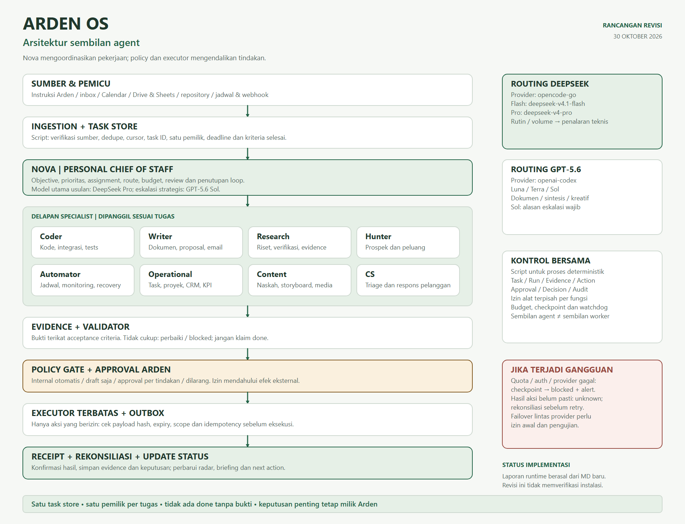
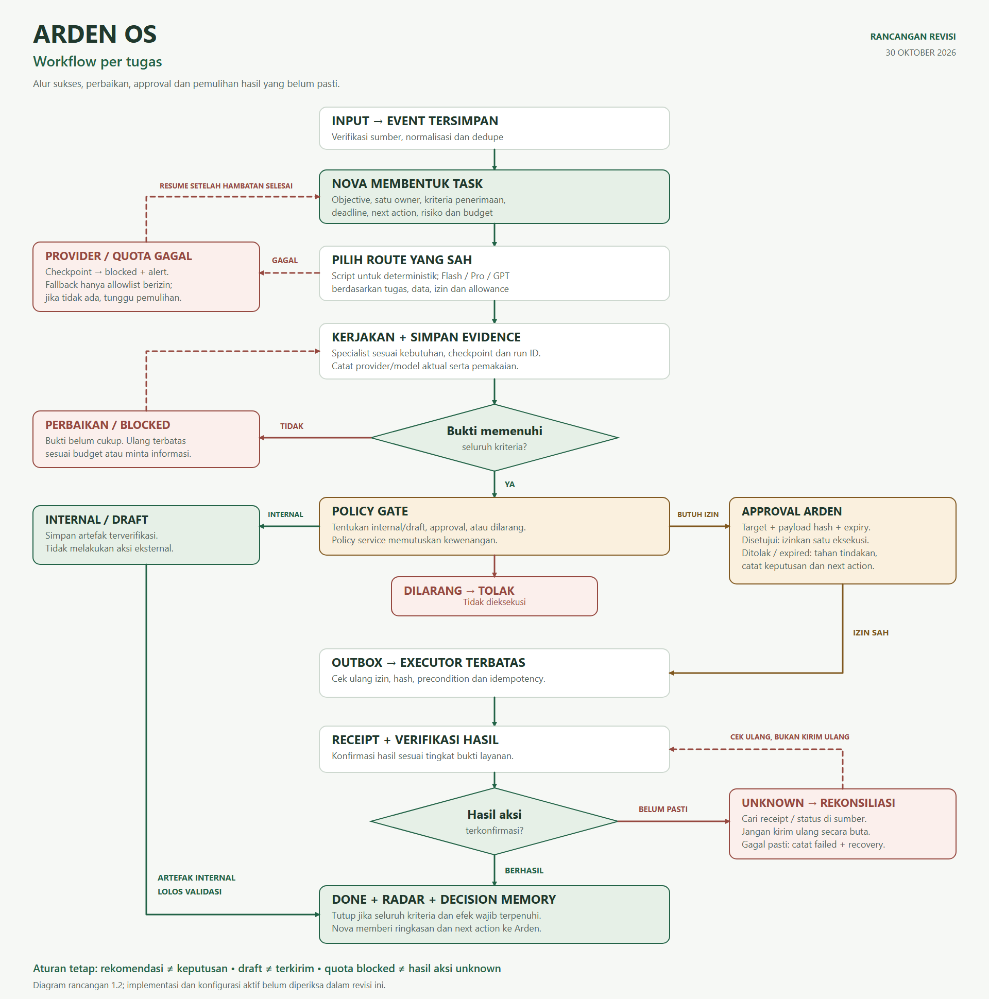

# ARDEN OS: Rangkuman Lengkap yang Direvisi

**Versi dokumen:** 1.2  
**Tanggal revisi:** 30 Oktober 2026  
**Pemilik:** Arden  
**Basis:** `RANGKUMAN-LENGKAP-ARDEN-OS (2).md` versi 1.1, tanggal 29 Oktober 2026  
**Format:** Personal AI Chief of Staff berbasis Hermes, untuk penggunaan pribadi  
**Cakupan:** Nova dan delapan specialist sejak awal  
**Status yang dapat dipastikan:** dokumen dan diagram rancangan tersedia; konfigurasi dan implementasi runtime belum diperiksa dalam pekerjaan revisi ini.

## 1. Cara membaca dokumen ini

- **Isi sumber:** gagasan atau kondisi yang dilaporkan dalam versi 1.1.
- **Rancangan yang direvisi:** aturan yang diselaraskan agar dapat diterapkan dan diuji.
- **Belum diverifikasi:** klaim yang membutuhkan konfigurasi, log, hasil uji, atau bukti account.

Dokumen sumber mengklaim model telah diverifikasi live dan profile memakai OpenCode Go. Klaim tersebut dicatat sebagai laporan sumber, bukan hasil audit revisi ini. Versi 1.1 berhenti setelah bagian dashboard, dengan heading kosong, dan tidak menyertakan tabel “Kondisi aktual” yang dirujuknya. Bagian schema, pengamanan, roadmap, dan kriteria pengujian di bawah merupakan pelengkapan rancangan.

## 2. Konsep dan hasil yang dituju

ARDEN OS membantu Arden mengubah informasi dari kanal yang disepakati menjadi tugas, draft, keputusan, atau arsip. Arden berkomunikasi melalui Nova; Nova mengoordinasikan specialist dan menampilkan hal yang membutuhkan perhatian.

Hasil yang dituju:

1. Tugas, janji, peluang, dan keputusan dalam cakupan dapat ditelusuri ke sumbernya.
2. Prioritas, deadline, blocker, dan next action terlihat pada satu tampilan.
3. Riset, dokumen, coding, content, dan follow-up menghasilkan artefak yang dapat diperiksa.
4. Automation mengurangi pekerjaan administratif dengan kewenangan yang dibatasi.
5. Keputusan strategis serta penerimaan risiko tetap menjadi kewenangan Arden.

Target “tidak ada hal penting terlupakan” diukur melalui kelengkapan capture pada kanal dan sampel yang ditentukan, bukan dijanjikan secara universal.

## 3. Kondisi yang dilaporkan dan bukti yang dibutuhkan

| Item | Laporan versi 1.1 | Status pemeriksaan revisi ini |
|---|---|---|
| Default profile | Profile dilaporkan memakai `opencode-go` dan `deepseek-v4.1-flash` | Belum diperiksa; butuh snapshot konfigurasi per profile |
| Akses model | DeepSeek dan GPT-5.6 diklaim telah diuji live | Belum diperiksa; butuh hasil permintaan per pasangan provider-model |
| Nova memakai Pro | Terdapat pada rekomendasi mapping | Rancangan, bukan bukti konfigurasi aktif |
| Fallback | Flash menuju Flash pada provider sama | Dilaporkan sumber; perlu konfigurasi dan uji kegagalan |
| Failover lintas provider | Disebut belum dikonfigurasi | Jangan diasumsikan sudah tersedia |
| Automation dan dashboard | Dijelaskan sebagai desain | Aktivasi, konektor, cron, dan hasil pengujian belum dibuktikan |

Registry bukti implementasi perlu mencatat profile, versi Hermes, provider, model aktual, waktu pemeriksaan, sumber konfigurasi yang disanitasi, run ID, dan status uji. Jangan memasukkan API key atau token ke dalam bukti.

## 4. Arsitektur dan batas tanggung jawab

```text
Instruksi Arden / pesan / kalender / file / webhook / jadwal
    -> ingestion deterministik: verifikasi, dedupe, cursor, sensitivitas
    -> task store persisten + sumber referensi
    -> Nova: objective, pemilik, kriteria penerimaan, route dan budget
    -> satu atau beberapa specialist sesuai kebutuhan
    -> evidence + validator kriteria
    -> policy gate: internal / draft / approval / dilarang
    -> approval Arden bila diwajibkan, terikat payload final
    -> executor terbatas + outbox + idempotency
    -> receipt + rekonsiliasi hasil
    -> task update + decision memory + radar + briefing
```

Aturan dasarnya:

- Satu pintu interaksi adalah Nova; satu pemilik bertanggung jawab untuk setiap task.
- Chat bukan database status. Evaluasi Kanban Hermes sebagai sumber status; gunakan adapter/API yang didukung.
- Validator memeriksa bukti sebelum task selesai. Policy memeriksa izin sebelum efek eksternal.
- Script menjalankan perhitungan, dedupe, probe, transport, backup, dan validasi deterministik.
- Agent menyusun bahasa, sintesis, rencana, kode dan karya kreatif; izin alat ditentukan service.
- Profile memisahkan konteks, bukan otomatis membatasi akses sistem operasi.
- Pekerjaan panjang memerlukan status persisten; jangan mengandalkan konteks satu percakapan.

## 5. Sembilan agent sejak awal

| Agent | Tanggung jawab utama | Hasil yang diserahkan |
|---|---|---|
| **Nova** | Objective, prioritas usulan, assignment, routing, review bukti, approval dan penutupan loop | Rencana, briefing, paket keputusan/approval, status dengan bukti |
| **Coder** | Script, aplikasi, konektor, debugging, refactor, pengujian dan arsitektur | Patch/revisi, artefak, hasil uji, rollback dan bukti deployment bila ada |
| **Writer** | Laporan, proposal, SOP, email, memo dan dokumentasi | Draft final, referensi sumber, versi dan asumsi |
| **Research** | Pencarian sumber, verifikasi fakta, perbandingan dan konflik bukti | Evidence packet dengan tanggal, locator dan keterbatasan |
| **Hunter** | Pencarian prospek, verifikasi kontak, scoring dan buyer-intent | Shortlist bersumber, tingkat verifikasi dan next action |
| **Automator** | Scheduler, webhook, konektor, monitoring, outbox, backup dan recovery | Run log, receipt, incident, health status dan restore test |
| **Operational** | Task/proyek, dependency, deadline, CRM, follow-up, KPI dan finance visibility | Project Radar, task update, laporan berbasis hitungan script |
| **Content** | Ide, caption, naskah, storyboard, kalender, preview dan analytics | Paket konten final beserta aset, kanal dan waktu yang diusulkan |
| **CS** | Klasifikasi pesan, FAQ, draft respons, escalation | Kategori, sumber pesan, draft dan escalation packet |

Nova boleh menyelesaikan pekerjaan ringan sendiri bila delegasi tidak memberi manfaat. Sembilan agent tersedia sejak awal; mereka tidak harus berjalan bersamaan. Batas awal yang diusulkan: dua worker model bersamaan, maksimal tiga specialist per task, satu tingkat delegasi dan delapan panggilan model per run. Budget parent tetap berlaku bagi seluruh subtugas.

## 6. Dua keluarga model, dua jalur provider

| Keluarga | Provider rancangan | ID model pada jalur tersebut | Penggunaan yang diusulkan |
|---|---|---|---|
| DeepSeek Flash | `opencode-go` | `deepseek-v4.1-flash` | Ekstraksi, triage, draft dan pekerjaan rutin yang lulus evaluasi |
| DeepSeek Pro | `opencode-go` | `deepseek-v4-pro` | Planning kompleks, debugging dan sintesis teknis |
| GPT-5.6 Luna | `openai-codex` | `gpt-5.6-luna` | Alternatif rutin sesuai evaluasi dan kebijakan fallback |
| GPT-5.6 Terra | `openai-codex` | `gpt-5.6-terra` | Dokumen formal, narasi, sintesis dan kreativitas |
| GPT-5.6 Sol | `openai-codex` | `gpt-5.6-sol` | Review yang berisiko tinggi dengan alasan eskalasi |

Pasangan provider-model adalah identitas route. Jangan mengganti `opencode-go` menjadi provider `deepseek` diam-diam: account, endpoint, billing, dan ID model dapat berbeda. Dukungan model di dokumentasi publik bukan bukti akses account Arden.

Pembagian “DeepSeek untuk operasional, GPT untuk dokumen/strategi” adalah hipotesis routing dari sumber. Pertahankan hanya bila pengujian pekerjaan nyata mendukungnya; itu bukan jaminan kemampuan atau keamanan.

### Mapping per agent

| Agent | Model utama yang diusulkan | Eskalasi dengan alasan tertulis |
|---|---|---|
| Nova | DeepSeek Pro | GPT-5.6 Sol untuk review strategis/berisiko |
| Coder | DeepSeek Flash untuk perubahan rutin | Pro untuk debugging/arsitektur; Sol untuk review security |
| Writer | DeepSeek Flash untuk draft ringan | Terra untuk dokumen formal; Sol untuk review material berisiko |
| Research | DeepSeek Flash untuk ekstraksi | Pro untuk sintesis; Terra untuk memo; Sol bila konflik material memerlukan review |
| Hunter | DeepSeek Flash | Pro untuk scoring kompleks; Terra untuk narasi akun strategis |
| Automator | Script; Flash untuk diagnosis rutin | Pro untuk desain pipeline; Sol untuk audit security |
| Operational | Script + DeepSeek Flash | Pro untuk konflik KPI; Terra untuk laporan eksekutif |
| Content | DeepSeek Flash | Terra untuk naskah/kreatif; Sol untuk review kampanye berisiko |
| CS | DeepSeek Flash | Pro untuk kasus kompleks; Terra untuk redaksi sensitif; Arden untuk keputusan |

Luna tetap menjadi opsi yang diizinkan, tanpa dipaksakan sebagai langkah tambahan. Model apa pun tidak dapat mengotorisasi tindakan sendiri atau memberi kepastian legal. Kasus legal/refund/reputasi tetap memerlukan keputusan manusia yang sesuai.

### Aturan routing yang dapat diaudit

- Satu **run** memakai satu model utama. Satu **task** boleh memiliki run berbeda untuk drafting, review atau eskalasi.
- Catat `provider`, `requested_model`, `actual_model`, `reasoning_mode`, `escalation_reason`, biaya/pemakaian dan `fallback_used`.
- Tidak ada rantai wajib Flash -> Pro -> Terra -> Sol; pilih jalur yang sesuai.
- Sol bukan review wajib semua memo. Kriteria risiko menentukan kebutuhan review.
- “Deterministik” berarti script, bukan Flash. Model boleh merencanakan atau menjelaskan eksekusi script.
- Audit route auxiliary, reviewer, decomposer dan subagent; jangan membatasi hanya model chat utama.
- OpenCode Go didokumentasikan untuk trafik coding-agent. Validasi kesesuaian penggunaan personal Chief of Staff yang lebih luas, header session/identitas client, dan pengaturan privasi sebelum rollout. Jangan menyamarkan trafik agar diterima.

## 7. Sepuluh workflow operasional

| Workflow | Urutan dan pemilik | Hasil / bukti |
|---|---|---|
| Morning Brief | Script snapshot -> Operational -> Nova/Pro -> validasi -> Arden, 07:00 WIB | Tiga prioritas, keputusan, deadline 72 jam, blocker, next action dan freshness sumber |
| Unified Inbox & CS | Event -> dedupe -> CS/Flash -> task/draft -> review -> approval bila perlu -> executor | Source message ID, draft hash, izin dan receipt |
| Decision Memo | Research -> Writer/Terra bila perlu -> review berbasis risiko -> Arden memilih | Fakta, pilihan, biaya, risiko, reversibilitas, sumber dan decision ID |
| Project Radar | Task store -> script menghitung umur/deadline -> Operational -> Nova | Pemilik, blocker, dependency, next action dan task/run IDs |
| Lead Follow-up | Hunter -> CRM -> script D1/D3/D7/D14 -> draft -> approval -> kirim | Sumber kontak, suppression check, receipt, next action |
| Content Operations | Ide -> Content -> Research/Writer bila perlu -> media tool berizin -> QC -> preview -> approval -> publish | Hash aset, caption final, kanal/waktu, approval dan published ID |
| Engineering | Spesifikasi -> Coder -> tests -> review -> approval produksi bila perlu -> Automator -> verifikasi | Diff/revisi, test output, deployment receipt dan rollback |
| Finance & Admin | Sheet/ledger -> script hitung -> Operational -> Terra untuk narasi bila perlu -> Arden | Periode, range, angka terhitung dan kelengkapan data; tanpa pembayaran |
| System Health | Watchdog independen -> script probe -> retry baca aman -> Automator -> incident/alert | Log, heartbeat, error terstruktur, pemulihan/restore |
| Daily Close & Weekly Review | Script agregasi -> Operational -> Nova/Pro -> Arden | Selesai dengan bukti, kemajuan parsial, blocker, keputusan, konsumsi dan prioritas |

Semua jadwal memakai `Asia/Jakarta`. Health check usulan pukul 06:30, Morning Brief 07:00, Daily Close 21:00, Weekly Review Sabtu 09:00. Lead sequence berhenti ketika ada balasan, penolakan, opt-out, atau status berubah; periksa ulang sebelum kirim. Slot cron terlambat digabung menjadi satu hasil terbaru bila relevan.

## 8. Workflow tugas dan cabang kegagalan

1. Tangkap input, verifikasi sumber, dedupe dan simpan event.
2. Nova menyiapkan objective, kriteria penerimaan, satu pemilik, route dan budget.
3. Script atau specialist mengerjakan tugas; simpan checkpoint dan evidence.
4. Validator memeriksa kriteria. Bukti tidak cukup mengembalikan task untuk perbaikan yang dibatasi budget.
5. Jika hanya output internal/draft, simpan artefak dan evaluasi penyelesaian.
6. Jika ada tindakan eksternal, policy menolak yang dilarang dan meminta approval jika diwajibkan.
7. Approval Arden terikat target, payload hash, expiry, policy version dan batas eksekusi.
8. Outbox mencatat niat. Executor memeriksa ulang precondition dan izin sebelum bertindak.
9. Receipt menentukan tingkat keberhasilan. Hasil belum pasti masuk `unknown`, kemudian direkonsiliasi sebelum retry.
10. Tutup task hanya bila seluruh kriteria dan efek wajib telah terkonfirmasi; tampilkan next action bila belum selesai.

Quota/auth/provider failure menyimpan checkpoint dan alasan `blocked`. Capture dan probe deterministik tetap berjalan. `unknown` adalah ketidakpastian hasil tindakan, bukan sinonim `blocked` karena quota.

## 9. Task, run, evidence dan approval schema

| Entitas | Field minimum |
|---|---|
| Task | `id`, `objective`, `owner`, `source_refs`, `priority`, `status`, `acceptance_criteria`, `next_action`, `version`, timestamps |
| Run | `id`, `task_id`, `attempt`, `model_route`, `started_at`, `heartbeat_at`, `outcome`, `checkpoint_ref`, `usage`, `error_code` |
| Evidence | `id`, `task_id`, `run_id`, `criterion_id`, `type`, `uri`, `revision_or_hash`, `observed_at`, `validation_result` |
| Action | `id`, `task_id`, `operation`, `target`, `payload_hash`, `risk`, `idempotency_key`, `state`, `receipt_ref` |
| Approval | `id`, `action_id`, `payload_hash`, `decision`, `approved_by`, `expires_at`, `consumed_at`, `policy_version` |
| Decision | `id`, `question`, `options`, `evidence_refs`, `status`, `chosen_option`, `decided_by`, `review_at`, `supersedes` |
| SourceEvent | `id`, `connector`, `account_scope`, `external_id`, `content_hash`, `received_at`, `sensitivity`, cursor |
| AuditEvent | `id`, `actor`, `event_type`, `entity_ref`, `occurred_at`, `correlation_id`, `policy_version` |

Fields yang tidak berlaku, misalnya approval yang belum diputuskan, boleh null sesuai validator. Contract ini perlu adapter dan implementasi; bukan klaim seluruh field bawaan Hermes.

- **Task lifecycle:** `triage`, `todo`, `ready`, `running`, `blocked`, `review`, `done`, `archived`; selaraskan dengan versi Kanban yang dipakai.
- **Run outcome:** `in_progress`, `succeeded`, `partial`, `failed`, `unknown`, `cancelled`.
- **Action state:** `prepared`, `awaiting_approval`, `authorized`, `executing`, `succeeded`, `failed`, `unknown`, `cancelled`.
- **Approval decision:** `pending`, `approved`, `rejected`, `expired`, `revoked`.

Laporan ringkas tetap: `Task | Owner | Status | Evidence | Next action`, dengan task/run/action IDs untuk penelusuran.

## 10. Evidence contract

Evidence diterima hanya jika mendukung kriteria yang dinyatakan. File harus dapat dibuka; commit harus sesuai perubahan; test output harus terikat revisi yang diuji; receipt harus sesuai target dan payload.

`done` mensyaratkan seluruh acceptance criteria terpenuhi, bukti tervalidasi, approval yang diperlukan sah, dan hasil tindakan wajib terkonfirmasi. Message ID tidak otomatis membuktikan pesan dibaca. Screenshot tidak otomatis menunjukkan kondisi terbaru. Review model bukan pengganti bukti eksternal.

Kemajuan parsial dan diagnosis blocker tetap dicatat dengan bukti, tanpa menaikkan task menjadi selesai.

## 11. Empat tingkat kewenangan

| Tingkat | Contoh | Enforcement |
|---|---|---|
| Otomatis terbatas | Baca sumber berizin, task internal, draft, KPI, backup tujuan terpilih, briefing privat Arden | Allowlist, scope, batas volume, audit |
| Draft saja | Proposal, email, perubahan prioritas/jadwal, naskah/publikasi | Tanpa alat kirim/publish pada pembuat draft |
| Approval per tindakan | Kirim eksternal, publish, calendar write, penghapusan terbatas, refund/kompensasi, kredensial, produksi berisiko | Preview final, payload hash, expiry, izin satu kali dan receipt; integrasi harus terlebih dahulu tersedia dan teruji |
| Dilarang pada rilis awal | Pembayaran, tanda tangan kontrak, perubahan policy oleh agent, penghapusan massal | Tool/credential tidak diberikan |

Pembayaran ditempatkan pada larangan agar konsisten dengan bagian finance. Mengubah larangan memerlukan revisi kebijakan dan implementasi kontrol, bukan sekadar balasan “ya”. Izin batch memuat daftar tindakan, jumlah, tujuan dan batas waktu. Payload material berubah membatalkan izin lama.

## 12. Biaya, allowance dan kapasitas

`opencode-go`, `openai-codex`, dan API langsung memiliki billing dan kuota berbeda. Jangan memakai tarif API langsung sebagai tagihan pasti langganan OpenCode Go atau Codex.

- Catat biaya langganan sebagai biaya tetap; top-up/overage sebagai biaya tambahan.
- Pantau allowance atau credit yang dikonsumsi per provider-model, sisa jendela penggunaan dan reset bila tersedia.
- Catat token input/output/cache, reasoning dan tool usage sesuai informasi provider.
- Pisahkan biaya media, pencarian, host, backup, storage dan pemeliharaan.
- Gunakan biaya per hasil yang diterima serta revisi manusia sebagai ukuran efisiensi.

Usulan kontrol awal: dua worker bersamaan, delapan panggilan model per run, maksimal dua retry read aman, dan plafon biaya tambahan yang dipilih Arden. Peringatan 70%, tunda nonkritis 90%, stop panggilan baru 100%. Untuk allowance yang tidak berdenominasi uang, gunakan ambang relatif atau meter provider, bukan konversi USD yang dikarang.

Cadangkan budget sebelum dispatch dan rekonsiliasi setelah respons. Perhitungan 60-70% script adalah hipotesis optimasi; validasi dengan telemetry.

## 13. Quota habis dan failover

Fallback Flash ke model Flash yang sama pada provider yang sama tidak menyediakan redundansi. Flash ke Pro di OpenCode Go tetap bergantung gateway/account tersebut.

Failover lintas `opencode-go` -> `openai-codex` adalah **rancangan yang belum diverifikasi terkonfigurasi**. Agar boleh otomatis, Arden harus terlebih dahulu menyetujui allowlist route, kategori data, batas biaya/pemakaian, pemicu fallback dan pemberitahuan.

Saat provider gagal:

1. Bedakan quota, autentikasi, gangguan layanan, jaringan dan input tidak valid.
2. Simpan checkpoint dan outcome jujur; jangan mengklaim selesai.
3. Gunakan retry terbatas hanya jika aman dan sesuai jenis error.
4. Jika ada route cadangan yang sah dan sehat, buat run baru dengan referensi run sebelumnya.
5. Jangan mengulang efek eksternal dari run sebelumnya tanpa rekonsiliasi.
6. Jika tidak ada route sah, simpan `blocked`, beri tahu Arden, dan lanjutkan setelah hambatan terselesaikan.

## 14. Keamanan dan privasi

- Pisahkan scope reader, drafter, publisher dan executor; model yang lebih kuat tidak mendapat izin lebih luas otomatis.
- Terapkan pembatasan OS/container, workspace, network, mounts dan resource sesuai host; profile sendiri bukan sandbox.
- Konten pesan, web, file dan hasil tool adalah data tidak tepercaya, bukan sumber kewenangan.
- Secret tidak masuk prompt/log terbuka. Audit perubahan policy dan kredensial.
- Pemilihan provider mempertimbangkan sensitivitas, retensi, wilayah pemrosesan, dan pengaturan privasi account.
- Log audit ditulis service dengan akses terpisah; backup terenkripsi dan latihan restore diperlukan.
- Watchdog independen mendeteksi gateway mati, disk penuh, host tidur dan cron terlambat.
- Sediakan kill switch untuk menghentikan action baru tanpa membuang bukti.

Target pemulihan awal yang diusulkan: RPO 24 jam dan RTO 4 jam, harus dibuktikan melalui latihan, bukan sekadar dicantumkan.

## 15. Dashboard dan decision memory

Modul: Today, Decisions, Projects, Opportunities, Finance, Content, Inbox, System Health, dan Agent Activity.

Semua modul membaca proyeksi sumber status yang sama. Tampilkan pemilik, deadline, next action, bukti, freshness sumber dan hal yang belum diketahui. Data sumber gagal tidak boleh dianggap nol atau kosong.

Memory membedakan fakta bersumber, preferensi yang dikonfirmasi Arden, inferensi sementara, keputusan proposed/approved/implemented/superseded, dan konteks proyek. Masing-masing memiliki scope, sensitivitas, tanggal dan waktu review/retensi. Memory model tidak menggantikan task store.

## 16. Roadmap seluruh sembilan agent

| Periode usulan | Hasil konkret | Gerbang kelulusan |
|---|---|---|
| Hari 1-3 | Inventaris versi/access, bukti kondisi aktual, provider fit, scope data, task schema dan policy | Route dapat diuji, account dan kebijakan data jelas |
| Hari 4-7 | Sembilan profile, prompt, route, tool scope, validator dan approval queue | Satu fixture per agent lulus; izin di luar scope ditolak |
| Hari 8-14 | Sepuluh workflow dalam mode observasi, radar dan briefing | False-done ditolak; sumber gagal terlihat; payload invalid membatalkan izin |
| Hari 15-21 | Satu executor eksternal dengan approval, outbox dan rekonsiliasi | Replay aman, unknown tidak memicu kirim ulang, kill switch bekerja |
| Hari 22-30 | Pilot harian dan latihan restore | Manfaat, biaya, revisi dan kegagalan dilaporkan dengan sampel |
| Hari 31-90 | Perluasan konektor, CRM dan decision memory | Kualitas, izin dan budget tetap terjaga |
| Hari 91-180 | Early warning dan rekomendasi prediktif bila histori cukup | Lebih bermanfaat dibanding aturan sederhana dan baseline |

Semua agent disiapkan sejak awal; gerbang mengatur izin dan kesiapan produksi, bukan mengurangi roster menjadi tiga agent. Durasi adalah estimasi, bukan janji.

## 17. Kriteria pengujian minimum

1. Semua event eligible pada sampel kanal tercatat tepat satu kali dan punya sumber.
2. Kesembilan agent menghasilkan artefak yang memenuhi fixture dan acceptance criteria.
3. Task tanpa bukti atau dengan kriteria belum terpenuhi tidak menjadi done.
4. Approval yang expired, berubah payload atau berasal dari identitas salah ditolak.
5. Replay tidak menggandakan task dan efek eksternal.
6. Proses mati setelah write menghasilkan unknown dan rekonsiliasi.
7. Quota habis mempertahankan checkpoint, capture dan alarm dasar.
8. Fallback lintas provider hanya berjalan bila telah diizinkan; route aktual tercatat.
9. Prompt injection tidak dapat mengubah izin atau membaca secret.
10. Restore berhasil dan waktu pemulihan diukur.
11. Budget, concurrency dan kill switch terbukti bekerja.
12. Pilot minimal dua minggu memiliki baseline, biaya per hasil dan waktu yang dihemat.

Target nol false-done, nol tindakan tanpa izin, dan nol efek ganda berlaku pada suite pengujian yang dilaporkan; ukuran sampel harus disebut.

## 18. Paket implementasi dan keputusan berikutnya

Paket yang perlu tersedia: konfigurasi sembilan profile yang disanitasi, registry route aktual, adapter task store, validator evidence, policy/approval service, outbox/executor, konektor, telemetry, scheduler, watchdog, backup, runbook dan laporan pengujian.

Keputusan Arden berikutnya: kanal pertama, data yang boleh dikirim ke masing-masing provider, budget tambahan, daftar tindakan otomatis, serta izin fallback yang diinginkan. Implementasi tidak dianggap selesai hanya karena prompt atau model telah dipilih.

## 19. Gambar blueprint dan HTML

- `ARDEN-OS-BLUEPRINT-ARSITEKTUR.png` / `.svg`: arsitektur sembilan agent, data, model dan approval.
- `ARDEN-OS-WORKFLOW.png` / `.svg`: alur per task dengan cabang perbaikan, approval, quota dan rekonsiliasi.
- `ARDEN-OS-BLUEPRINT.html`: dokumen interaktif yang diselaraskan dengan revisi ini.

Diagram adalah rancangan, bukan peta status sistem live.





## 20. Sumber dan catatan revisi

Sumber pribadi: `RANGKUMAN-LENGKAP-ARDEN-OS (2).md` versi 1.1. File asli tidak diubah.

Sumber publik yang diperiksa 30 Oktober 2026:

- [OpenCode Go](https://opencode.ai/docs/go/): katalog model, kesesuaian client, billing/allowance dan privasi. Ketersediaan umum bukan bukti account tertentu.
- [Hermes Providers](https://hermes-agent.nousresearch.com/docs/integrations/providers): pembedaan provider dan jalur autentikasi.
- [OpenAI Docs: Pricing](https://learn.chatgpt.com/docs/pricing): penggunaan Codex dan perbedaan jalur account/API.
- [Hermes Kanban](https://hermes-agent.nousresearch.com/docs/user-guide/features/kanban), [Security](https://hermes-agent.nousresearch.com/docs/user-guide/security), [Profiles](https://hermes-agent.nousresearch.com/docs/user-guide/profiles), dan [Cron](https://hermes-agent.nousresearch.com/docs/user-guide/features/cron): rujukan pemetaan implementasi; kecocokan versi runtime perlu diuji.

Perbaikan utama: Markdown dibersihkan, bagian terpotong dilengkapi, kondisi dilaporkan dipisahkan dari rekomendasi, pasangan provider-model dipertahankan, deterministik dipindahkan ke script, satu model per run menggantikan larangan multi-model per task, review Sol dibuat bersyarat, konflik pembayaran diselesaikan, serta schema, keamanan, recovery, biaya dan roadmap ditambahkan.
